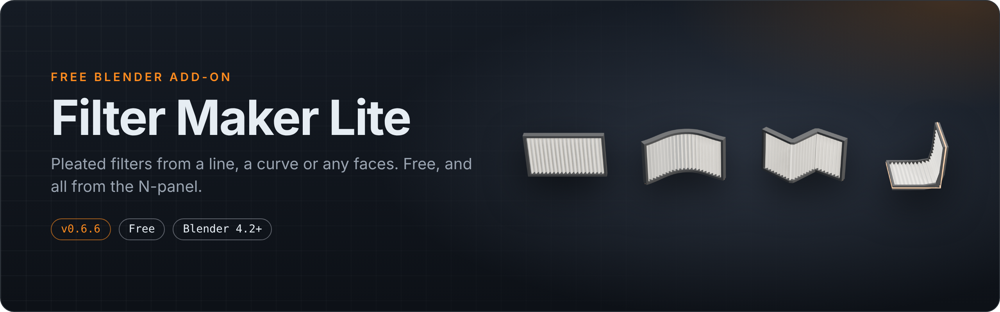
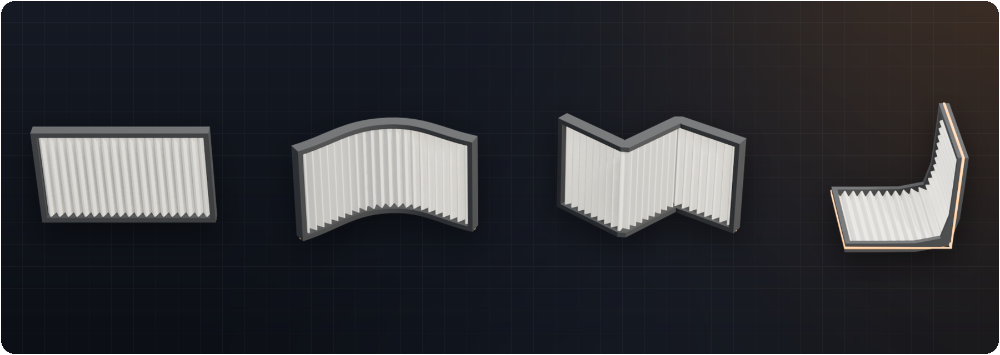
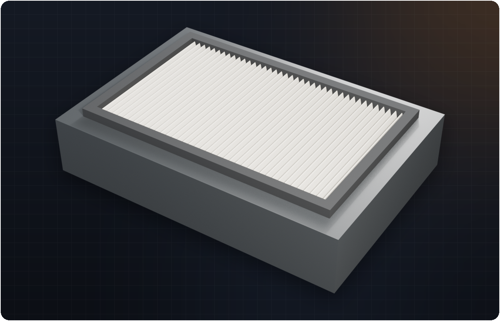
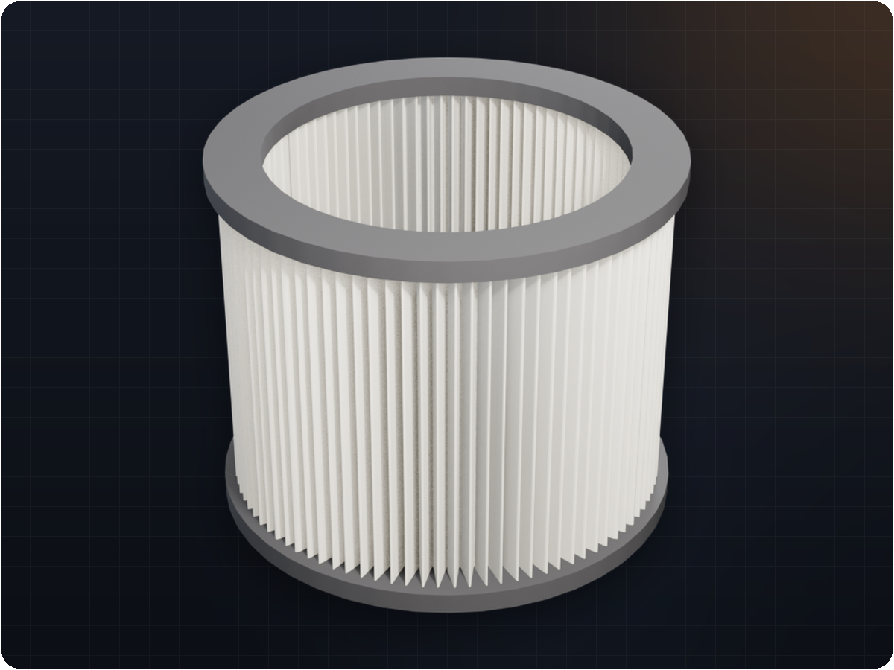
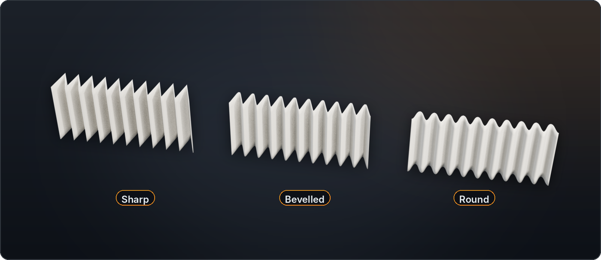
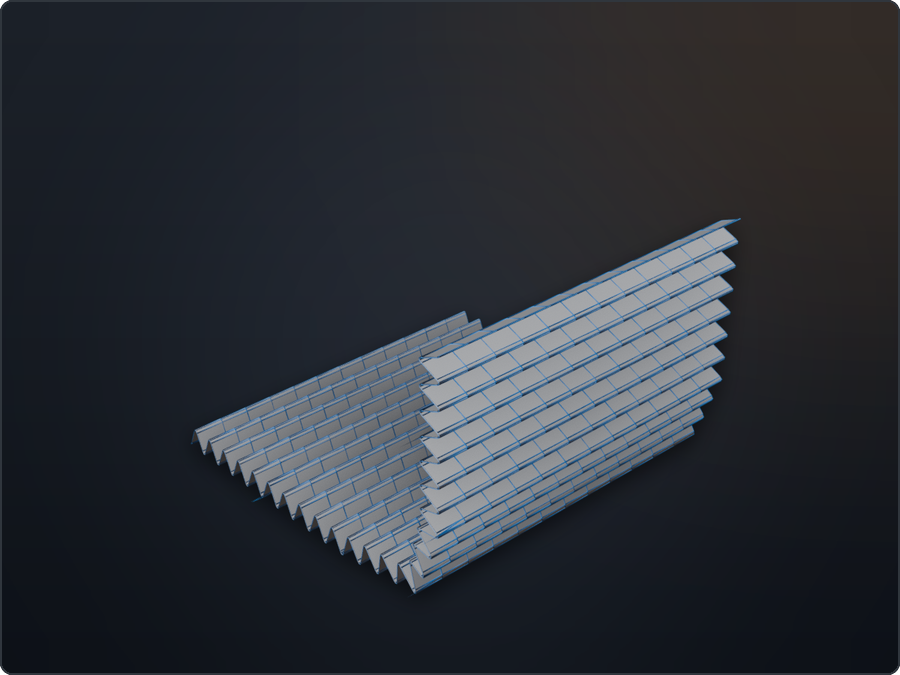

  

  
  
  
  
  
  
  

  <b>Make pleated air filters in Blender from a line, a curve, mesh edges or faces.</b> 
  Free, no node setup, everything in the N-panel. The free edition of <a href="https://github.com/Tooboi/FilterMakerPro">Filter Maker Pro</a>.

---

## ✨ What you get

- **Four ways to start:** *New Filter Line*, any curve (open or closed), selected mesh edges, or selected faces. Neighbouring faces become one continuous pleated sheet that runs around corners.
- **Pleat shaping:** density, depth, offset, pleat angle, surface detail, height and direction, and optional thickness.
- **Pleat bevel:** ridge and valley bevel with cuts, from sharp paper folds to soft rounded media.
- **Clean topology:** face filters are remeshed on a structured quad grid with welded seams and smooth normals across panel joins. Triangles are one click away.
- **A clean border:** a flat frame with the width you choose, sealed so the pleat ends never poke through.
- **Boolean tool:** cut the source mesh with a box, an envelope of the pleated form or any object, so the filter sits in its housing. Applied when you finish.
- **Real UVs:** the pleated sheet is unrolled across the folds, so textures keep their size on every flank and on the frame.
- **Live editing:** change a slider and the filter rebuilds; curve sources stay editable.

<table>
  <tr>
    <td width="50%"></td>
    <td width="50%"></td>
  </tr>
  <tr>
    <td align="center"><b>Boolean.</b> The source mesh is cut so the filter sits in its housing</td>
    <td align="center"><b>Curve mode.</b> A closed curve becomes a ring filter</td>
  </tr>
  <tr>
    <td></td>
    <td></td>
  </tr>
  <tr>
    <td align="center">Pleat bevel: sharp, bevelled, round</td>
    <td align="center">Clean quads that follow the fold</td>
  </tr>
</table>

## Lite vs Pro

| | Lite (free) | [Pro](https://github.com/Tooboi/FilterMakerPro) |
|---|:---:|:---:|
| Line, curve, edge and face sources | ✅ | ✅ |
| Pleat density, depth, angle, thickness | ✅ | ✅ |
| Pleat bevel, quads / tris, shading | ✅ | ✅ |
| Flat border | ✅ | ✅ |
| Boolean tool (cut the source mesh) | ✅ | ✅ |
| UVs unrolled across the folds | ✅ | ✅ |
| Border profiles (Chamfer, Round, Lip), overhang, front / back, end caps | | ✅ |
| Ready-made shapes (cartridge, V-bank, box wrap, die-cut furnace…) | | ✅ |
| Die-cut board face, wire mesh, pull tabs, printed labels | | ✅ |
| Built-in materials and dirt | | ✅ |
| Wear (Clouds displace) | | ✅ |
| Hair & dust | | ✅ |
| Game-ready low poly, baked maps, FBX / glTF export | | ✅ |
| Presets (built-in and your own) | | ✅ |

Filters you make in Lite open in Pro with every setting intact, so you can upgrade at any time without redoing your work. Only one edition can be enabled at a time: disable Lite before enabling Pro.

## 📦 Installation

**Requires Blender 4.2 LTS or newer** (tested on 5.2 LTS).

**Easiest: from Blender Extensions.** In Blender, open *Edit → Preferences → Get Extensions*, search for **Filter Maker Lite** and click **Install**. Or open the [Filter Maker Lite page on Blender Extensions](https://extensions.blender.org/add-ons/filter-maker-lite/).

**Or from GitHub:**

1. Download `FilterMakerLite-x.y.z.zip` from the [latest release](https://github.com/Tooboi/FilterMakerLite/releases/latest). Don't unzip it.
2. Drag it into Blender, or go to *Edit → Preferences → Get Extensions → ⌄ → Install from Disk…*
   (Legacy: *Add-ons → Install from Disk…*, then enable **Object: Filter Maker Lite**.)
3. Press <kbd>N</kbd> in the 3D Viewport and open the **Filter Maker** tab.

## 🚀 Quick start

| I want… | Do this |
|---|---|
| A flat strip / quick test | Click **New Filter Line**. Click **Edit** next to *Live curve guide* to reshape it. |
| A filter along a path or ring | Select a curve → **From Curve / Edges**. Set **Height** and **Height Direction**. |
| A filter that fills a shape | Select a mesh, go to Edit Mode, select faces → **From Faces**. |
| A filter from a wire outline | Select mesh edges in Edit Mode → **From Curve / Edges**. |

Then work down the panel: **Pleats → Pleat Bevel → Shading → Border → Boolean**, and click **Finish (Bake)** when you're done.

| To set a filter into a model | Do this |
|---|---|
| Recess it into a housing | Make the filter **From Faces** on the housing mesh, then turn on **Boolean** with **Envelope** and **Difference**. The housing is cut around the filter; the cut is applied when you click **Finish (Bake)**. |

## About this repository

This add-on is generated from the Filter Maker Pro source by `tools/build_lite.py` in the [Pro repository](https://github.com/Tooboi/FilterMakerPro), so both editions share the same core and get the same fixes. Please report bugs in the [issues](https://github.com/Tooboi/FilterMakerLite/issues) here.

## 📄 License

[GPL-3.0](LICENSE) © Tooboi, like Blender itself. Free for personal and commercial work; the filters you make are yours.
